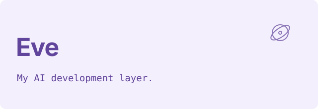
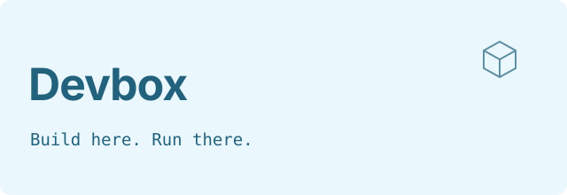
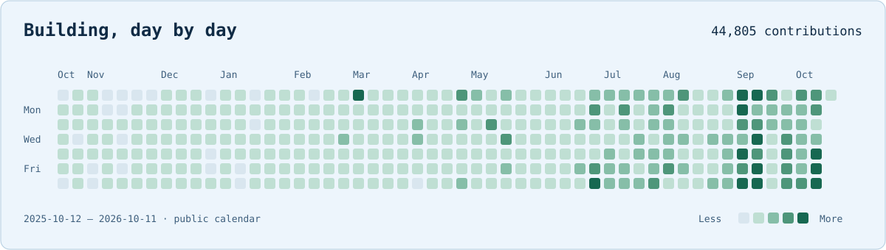

<picture>
  <source media="(prefers-color-scheme: dark) and (prefers-reduced-motion: reduce)" srcset="assets/hero-dark-static.svg">
  <source media="(prefers-reduced-motion: reduce)" srcset="assets/hero-light-static.svg">
  <source media="(prefers-color-scheme: dark)" srcset="assets/hero-dark.svg">
  
</picture>

**I build products and the tools behind them.**  
From everyday services to developer workflows, I care about making complex things feel simple.

## `01 /` Products I build

<table>
<tr>
<td width="50%" valign="top">
<a href="https://fixit.app"><picture><source media="(prefers-color-scheme: dark)" srcset="assets/fixit-dark.svg"></picture></a>
<h3>Help for your home.</h3>

Real-time and scheduled home services in Czechia — from an urgent fix to a scheduled pro.

<a href="https://fixit.app">Explore FixIt ↗</a>

</td>
<td width="50%" valign="top">
<a href="https://reservine.io/en"><picture><source media="(prefers-color-scheme: dark)" srcset="assets/reservine-dark.svg"></picture></a>
<h3>Spaces that run themselves.</h3>

Reservations, payments, and smart access — one system for self-service businesses.

<a href="https://reservine.io/en">Explore Reservine ↗</a>

</td>
</tr>
</table>

## `02 /` The systems behind my work

**AI assistance → execution → feedback.** Three parts of the workflow I’m building around my products.

<table>
<tr>
<td width="33%" valign="top">
<a href="docs/eve.md"><picture><source media="(prefers-color-scheme: dark)" srcset="assets/eve-dark.svg"></picture></a>
<h3>AI assistance.</h3>

My AI layer for development workflows, including pull-request summaries and session visibility.

<a href="docs/eve.md">Meet Eve ↗</a>

</td>
<td width="33%" valign="top">
<a href="docs/devbox.md"><picture><source media="(prefers-color-scheme: dark)" srcset="assets/devbox-dark.svg"></picture></a>
<h3>An execution environment.</h3>

Remote development workspaces that keep dev servers, builds, and tests off my laptop.

<a href="docs/devbox.md">Explore Devbox ↗</a>

</td>
<td width="33%" valign="top">
<a href="https://github.com/henderson-tech/vitrinka-kit"><picture><source media="(prefers-color-scheme: dark)" srcset="assets/vitrinka-dark.svg"></picture></a>
<h3>A connected feedback loop.</h3>

Boards, UI annotations, and tooling that connect people, interfaces, and agents.

<a href="https://github.com/henderson-tech/vitrinka-kit">Explore the public kit ↗</a>

</td>
</tr>
</table>

## `03 /` Personal tools, made public

<a href="https://github.com/LEFTEQ/PultikPublic"><picture><source media="(prefers-color-scheme: dark)" srcset="assets/pultik-dark.svg"></picture></a>

**Pultík** is a macOS menu-bar command center: personal tooling with a sanitized public source mirror.

[Explore Pultík’s source ↗](https://github.com/LEFTEQ/PultikPublic)

## `04 /` My engineering toolbox

<table>
<tr>
<td width="100%" valign="top">
<a href="https://github.com/LEFTEQ/ClaudikPublic"><picture><source media="(prefers-color-scheme: dark)" srcset="assets/claudik-dark.svg"></picture></a>

My public development setup: skills, commands, hooks, and documentation.

<a href="https://github.com/LEFTEQ/ClaudikPublic">Explore the setup ↗</a>

</td>
</tr>
</table>

`TypeScript` · `React / Expo` · `Go` · `PostgreSQL` · `Swift`

## `05 /` Building, day by day

<picture>
  <source media="(prefers-color-scheme: dark)" srcset="assets/contributions-dark.svg">
  
</picture>

GitHub contributions, not just commits. Includes anonymous counts from private work — never private project names or details. Refreshed daily from the publicly visible calendar. [View activity ↗](https://github.com/LEFTEQ?tab=overview)

## `06 /` Connect with me

Find me elsewhere: [LinkedIn ↗](https://www.linkedin.com/in/lukas-pribik-dev/) · [Instagram ↗](https://www.instagram.com/lefteq/)

---

Make complex things simple. — Lukáš / LEFTEQ
